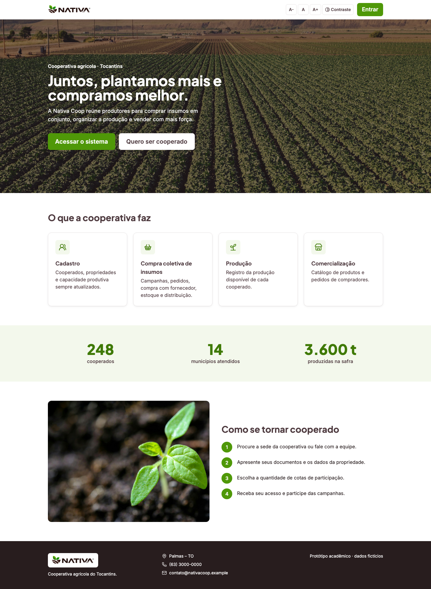
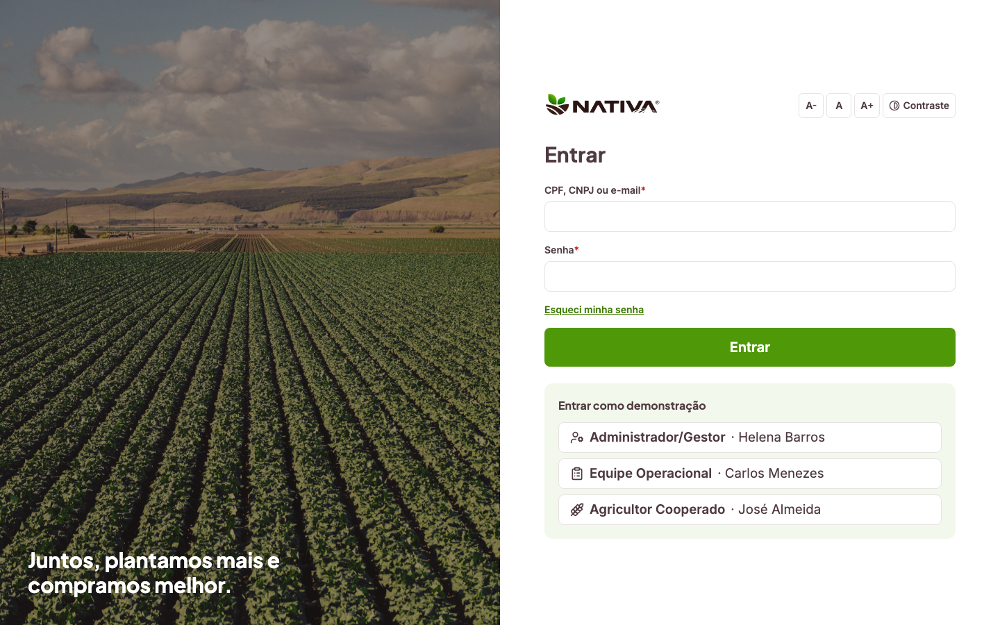
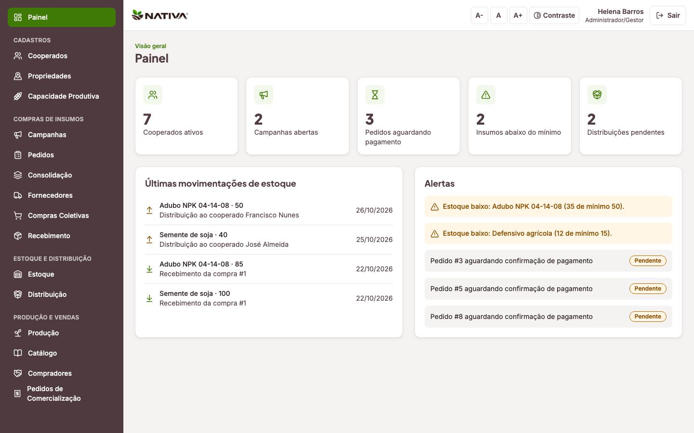
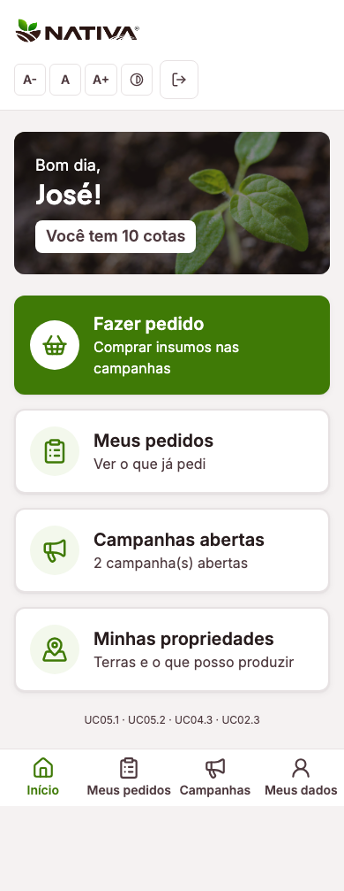

<div align="center">


# 🌱 Nativa Coop

**Plataforma web para organizar as operações de uma cooperativa agrícola comunitária.**


[Visão geral](#-visão-geral) · [Telas](#-telas) · [Módulos](#-módulos) · [Fluxos](#-fluxos) · [Como rodar](#-como-rodar-o-projeto) · [Integrantes](#-integrantes)

</div>

---

## 📖 Visão geral

A Nativa Coop propõe reunir, em uma plataforma web responsiva, as informações que a cooperativa usa para organizar os cooperados, comprar e distribuir insumos e comercializar a produção agrícola.

Quando essas informações ficam dispersas, a equipe precisa conciliar pedidos, registros de estoque e produtos disponíveis em lugares diferentes. A proposta é centralizar esses registros para reduzir retrabalho e facilitar o acompanhamento das operações, da solicitação de insumos à entrega aos cooperados.

## 🖼️ Telas

O protótipo é navegável e usa dados simulados no `localStorage`, sem backend. Há três perfis de demonstração na tela de login.

| Landing page | Login |
| :---: | :---: |
|  |  |
| **Painel de gestão** | **Início do produtor** |
|  |  |

A lista completa das telas por requisito está em [TELAS.md](TELAS.md) e as capturas ficam na pasta [prints/](prints).

## 🧩 Módulos

| Módulo | Funcionalidades previstas | Requisitos |
| --- | --- | --- |
| 🌾 **Gestão de Cooperados** | Cadastrar, editar e consultar cooperados, propriedades vinculadas e informações sobre capacidade produtiva. | RF01–RF03 |
| 🤝 **Compras Coletivas** | Organizar campanhas, registrar pedidos de insumos, consolidar solicitações, gerenciar fornecedores e registrar recebimentos. | RF04–RF08 |
| 📦 **Estoque e Distribuição** | Registrar entradas, consultar o saldo disponível e acompanhar a distribuição de insumos aos cooperados. | RF09–RF10 |
| 🛒 **Comercialização** | Registrar a produção disponível para venda, organizar o catálogo e acompanhar os pedidos dos compradores. | RF11–RF13 |

## 🔄 Fluxos

### Da solicitação à distribuição de insumos

1. O **Administrador/Gestor da Cooperativa** abre uma campanha de compras coletivas.
2. O **Agricultor Cooperado** informa ao gestor os insumos de que precisa. O gestor registra o pedido e verifica os limites proporcionais às cotas de participação.
3. O gestor consolida as solicitações por código do produto e unidade de medida. A documentação prevê consolidação parcial com controle dos saldos pendentes.
4. Após a compra, a cooperativa registra o recebimento, atualiza o estoque e acompanha as entregas aos cooperados.

### Da produção ao pedido de venda

1. A cooperativa registra a produção disponível para comercialização.
2. Os produtos disponíveis são organizados no catálogo.
3. A **Equipe Operacional/Administrativa** registra, consulta e atualiza os pedidos dos compradores conforme o andamento de cada solicitação.

### Casos de uso por módulo

#### Gestão de Cooperados

| Requisito | Caso de uso | Operações previstas |
| --- | --- | --- |
| RF01 | Gerenciar cooperados | Cadastrar, editar e consultar cooperados. |
| RF02 | Gerenciar propriedades | Cadastrar, editar e consultar propriedades vinculadas aos cooperados. |
| RF03 | Gerenciar capacidade produtiva | Registrar, editar e consultar a capacidade produtiva dos cooperados. |

#### Compras Coletivas

| Requisito | Caso de uso | Operações previstas |
| --- | --- | --- |
| RF04 | Gerenciar campanhas | Criar, editar e consultar campanhas de compra coletiva. |
| RF05 | Gerenciar pedidos de insumos | O gestor registra a solicitação do cooperado e verifica o limite por cotas. O pedido pode ser consultado e, enquanto estiver registrado e ainda não tiver sido consolidado, editado pelo gestor. |
| RF06 | Gerenciar compras coletivas | Consolidar, consultar e atualizar solicitações consolidadas. O agrupamento usa o código do produto e a unidade de medida, com controle de saldos pendentes nas consolidações parciais. |
| RF07 | Gerenciar fornecedores | Cadastrar, editar e consultar fornecedores. |
| RF08 | Gerenciar recebimento de insumos | Registrar e consultar recebimentos e conferir os insumos recebidos. |

#### Estoque e Distribuição

| Requisito | Caso de uso | Operações previstas |
| --- | --- | --- |
| RF09 | Gerenciar estoque | Registrar a entrada dos insumos recebidos, consultar o estoque e atualizar as quantidades disponíveis. |
| RF10 | Gerenciar distribuição de insumos | Registrar e consultar distribuições e registrar as quantidades distribuídas aos cooperados. |

#### Comercialização

| Requisito | Caso de uso | Operações previstas |
| --- | --- | --- |
| RF11 | Gerenciar produção | Cadastrar, atualizar e consultar a produção disponível para comercialização. |
| RF12 | Gerenciar catálogo | Cadastrar, atualizar e consultar produtos no catálogo comercial. |
| RF13 | Gerenciar pedidos de comercialização | A Equipe Operacional/Administrativa registra, consulta e atualiza os pedidos dos compradores. |

## ✅ Requisitos de qualidade

- **Responsividade e acessibilidade** para uso em diferentes tamanhos de tela.
- **Autenticação e controle de acesso** de acordo com o perfil do usuário.
- **Integridade dos dados** nas movimentações de estoque.
- **Rastreabilidade** por meio do registro de operações.
- **Usabilidade, desempenho e compatibilidade** como critérios de qualidade da aplicação.

## 📚 Documentação e andamento

O README foi elaborado com base no documento revisado de **Modelagem de Software da Nativa Coop**. A modelagem reúne requisitos, regras de negócio, diagramas, telas e matriz de rastreabilidade. As funcionalidades descritas aqui representam o escopo previsto para a implementação.

## 🚀 Como rodar o projeto

Aplicação em **SvelteKit** com **TypeScript** e **Tailwind CSS v4**. É necessário ter o [Node.js](https://nodejs.org) instalado.

```sh
git clone https://github.com/bandeirahx/coop-nativa.git
cd coop-nativa
npm install
npm run dev      # servidor de desenvolvimento
npm run build    # build de produção
npm run preview  # pré-visualiza o build
```

### Trabalhando em grupo

```sh
git pull                         # antes de começar, traga as novidades
git checkout -b minha-tarefa     # trabalhe em uma branch própria
git add . && git commit -m "descreva a mudança"
git push -u origin minha-tarefa  # depois abra um Pull Request
```

### Deploy

O projeto já tem o arquivo `vercel.json`. Basta importar o repositório na [Vercel](https://vercel.com) e clicar em **Deploy**; cada push na `main` publica uma nova versão.

## 👥 Integrantes

| Nome | GitHub |
| --- | --- |
| Isadora Martins Barbosa | `@________` |
| Jacyane Carvalho Martins | [@Izzieee](https://github.com/Izzieee) |
| Matheus Almeida Cirqueira | [@bandeirahx](https://github.com/bandeirahx) |
| Raquel Aires Pimenta Silva | [@RaquelAires](https://github.com/RaquelAires) |
| Reginaldo Santos Andrade | [@reginaldoandrade-inf](https://github.com/reginaldoandrade-inf) |
| Ryllen Alves da Silva Nascimento | [@Ryllen](https://github.com/Ryllen) |

---

<div align="center">

Feito com 💚 pela equipe da Nativa Coop · Ulbra Palmas – TO

</div>
